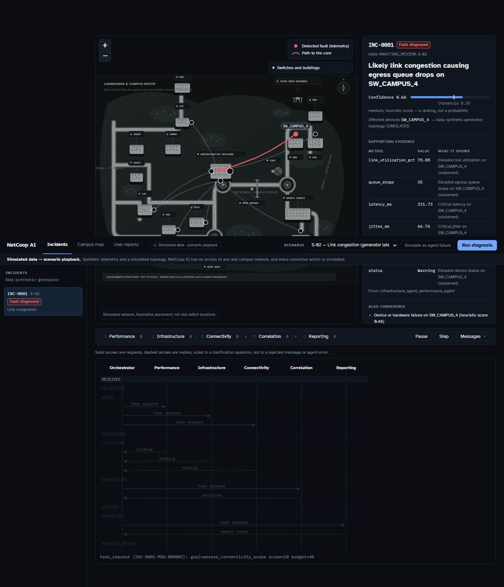
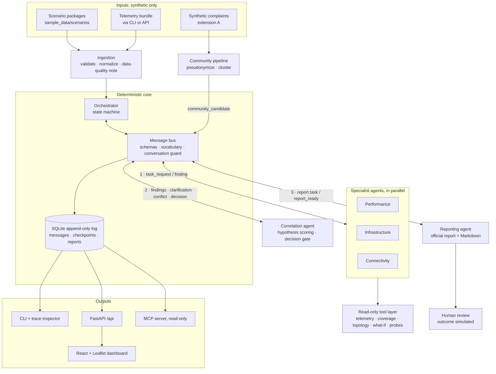
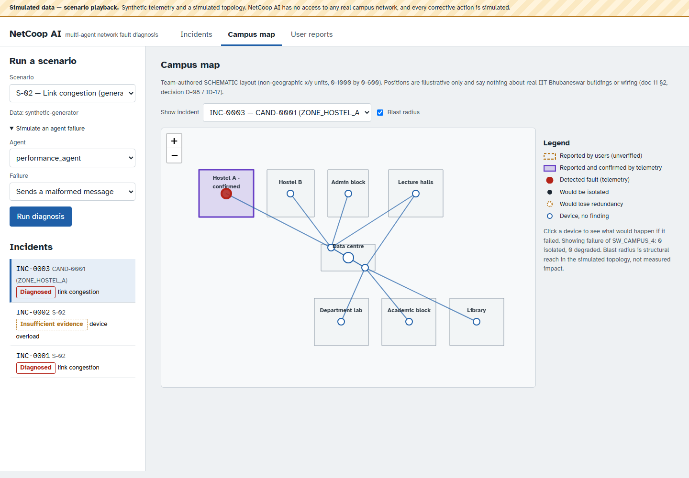
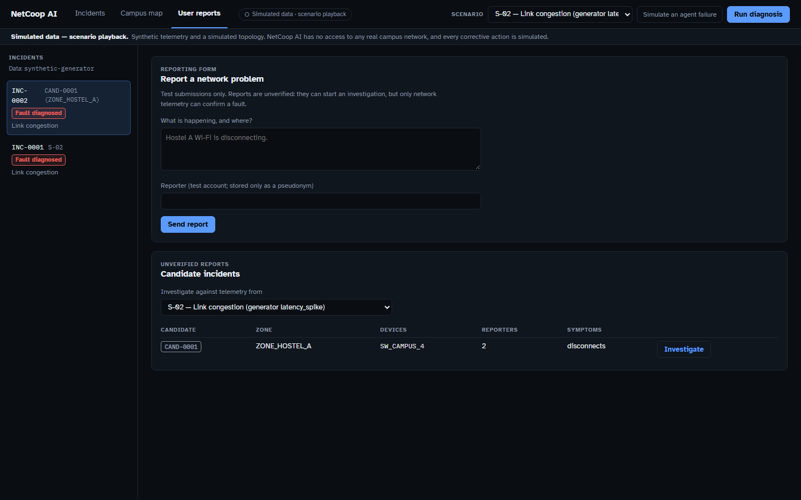

<div align="center">

# NetCoop AI

### Multi-Agent Network Fault Diagnosis and Interoperability

Five cooperating agents examine campus network telemetry, exchange validated protocol messages,
weigh competing explanations, and produce one evidence-based diagnostic report.
When the evidence is too thin, the system says so instead of guessing.


<br>


*Built for the IIT Bhubaneswar Agentic AI Hackathon.*

</div>

> [!IMPORTANT]
> **Simulation mode only.** NetCoop AI runs on synthetic telemetry (from the organizers' generator plus team-authored variants) and a simulated topology. It has **no access to any IIT Bhubaneswar network**, it does **no live monitoring**, and every corrective action is **simulated**: approving one records a decision and changes nothing outside the application. Confidence values are heuristic scores, not calibrated probabilities.



<p align="center"><sub>Incident screen for scenario S-02 (link congestion): simulated switches on an illustrative campus map, the diagnosis with its evidence, and the five agents' message activity.</sub></p>

---

## Contents

[The problem](#the-problem) ·
[Our approach](#our-approach) ·
[Key capabilities](#key-capabilities) ·
[Architecture](#system-architecture) ·
[How the agents collaborate](#how-the-agents-collaborate) ·
[Documentation](#documentation) ·
[Quick start](#quick-start) ·
[Demo](#demo-and-screenshots) ·
[Testing](#testing-and-validation) ·
[Deployment](#deployment) ·
[Limitations](#safety-limitations-and-current-status) ·
[Roadmap](#roadmap)

---

## The problem

A slow or failing campus network rarely has a single obvious cause. The same symptom, such as high latency in one hostel, can come from a congested uplink, an overloaded switch, a failing interface, a DNS outage, or simply bad telemetry. Diagnosing it means:

- **Correlating evidence from different specialists.** Performance counters, device health and topology are separate views of the same incident. Each one alone is incomplete.
- **Working across inconsistent data.** Fields get renamed, units differ, schema versions change and metrics go missing. A tool that treats missing data as healthy data will reach confident, wrong conclusions.
- **Explaining the conclusion.** A network engineer needs to see *why* a cause was chosen, which alternatives were considered, and what could not be assessed. An unexplained prediction is not enough.

The hackathon problem statement asks for a system in which multiple AI agents communicate in a structured, interoperable way and consolidate their findings into one diagnostic report. Reliable multi-agent interoperability and evidence-based diagnosis are the central focus.

## Our approach

NetCoop AI splits the investigation across **five agents with distinct responsibilities**, coordinated by a **deterministic orchestrator**:

1. Three **specialists** (performance, infrastructure, connectivity) investigate the incident in parallel and independently. Each reads data only through a read-only tool layer and decides for itself what to look at next.
2. A **correlation agent** scores competing explanations against all the findings. It can ask bounded clarification questions or raise a conflict, and then either commits to a diagnosis or declares the evidence insufficient.
3. A **reporting agent** turns the decision into the official ten-key JSON report, plus a Markdown report with evidence, alternatives, limitations and approval-gated recommendations.

Agents never call each other directly. Every message passes through the orchestrator on a **versioned JSON protocol (currently 1.2)**, where it is validated against schemas, a controlled vocabulary and a conversation guard. Every attempt, accepted or rejected, is appended to a SQLite log, so each conclusion can be traced back to the messages and measurements behind it.

The diagnosis itself is **deterministic and works without any LLM**. The same input and configuration give the same states, decision, scores and report.

## Key capabilities

Each capability below is implemented and covered by automated tests. Status per official component: [release verification §3](docs/results/release-verification.md#3-component-status).

| Capability | What it does | Read more |
|---|---|---|
| **Multi-agent diagnosis** | Five agents, each with its own goal, tools, call budget and abstention rules. The specialists run in parallel. | [doc 03](docs/03-agents.md) |
| **Interoperability protocol** | Versioned envelope (1.0 → 1.1 → 1.2, backward compatible), payload schemas, controlled vocabularies, semantic rules, an authority matrix and a conversation guard enforced on every message | [doc 05](docs/05-protocol-spec.md) |
| **Conformance kit** | JSON Schemas plus valid, invalid and conversation examples, checked by one command (`netcoop conformance`) | [conformance/](conformance/README.md) |
| **Telemetry ingestion and validation** | Structure, schema-version, field-mapping, unit and plausibility checks. Bundles are accepted, accepted with warnings, or rejected with a specific error code. | [doc 05 §6](docs/05-protocol-spec.md), [doc 06](docs/06-field-dictionary.md) |
| **Evidence-based root-cause assessment** | A hypothesis catalog with heuristic scoring and a decision gate gives `diagnosed`, `insufficient_evidence`, `no_fault_detected` or `failed`. Missing data is reported as *not assessable*, never as healthy. | [doc 08](docs/08-diagnosis-and-confidence.md) |
| **Topology correlation** | Dependency paths, what-if failure and blast radius over a simulated topology (`networkx`) | [doc 03 §2.3](docs/03-agents.md), [doc 11](docs/11-geospatial-network-intelligence.md) |
| **Clarification and conflict exchange** | Typed clarification questions, capped at 2 rounds by default. Protocol 1.2 conflict reports are relayed to the named agent, which re-checks its data. | [doc 04 §6](docs/04-orchestration.md), [doc 05 §19](docs/05-protocol-spec.md) |
| **Reporting and traceability** | The official report keeps exactly the ten keys from the problem statement, with an additive extension block and a Markdown version. The protocol inspector replays any incident as a table, a sequence diagram, JSON or an evidence chain. | [doc 07](docs/07-report-spec.md), [doc 05 §18](docs/05-protocol-spec.md) |
| **Failure handling** | Agent timeout, error and invalid-message injection, retry once and then continue on reduced evidence, and a fallback report builder | [doc 04 §5](docs/04-orchestration.md) |
| **Pause, resume and crash recovery** | Append-only checkpoints. An incident that was paused or crashed resumes in a new process with the same result as an uninterrupted run. | [doc 04 §10](docs/04-orchestration.md) |
| **Human review and simulated remediation** | Recommendations need a recorded human approval. The tool layer has no write operations, and the outcome shown is simulated. | [doc 12 §3, §8](docs/12-safety-privacy-simulation-policy.md) |
| **Scenario simulation** | 13 frozen scenario packages, from normal operation through link congestion and DNS failure to incompatible schemas, missing data, agent failure and conflicting measurements | [doc 09](docs/09-scenarios-and-testing.md) |
| **MCP interface** | A read-only MCP server exposes the tool layer and resources. The specialists can optionally read their data through it and produce identical findings. | [doc 16](docs/16-mcp.md) |
| **Campus dashboard** *(extension B)* | A React + Leaflet dashboard: incident screen, schematic campus map with blast radius, and message replay | [doc 11 §12](docs/11-geospatial-network-intelligence.md) |
| **Community signals** *(extension A)* | Synthetic user complaints are pseudonymized and clustered into *unverified* candidate incidents that can start an investigation | [doc 10](docs/10-community-signal-intelligence.md) |

## System architecture



How to read it: all agent traffic is **hub-and-spoke through the orchestrator and the bus**. There are no direct agent-to-agent calls, and the guard rejects any attempt (`DIRECT_AGENT_MESSAGE_FORBIDDEN`). Agents read data only through the tool layer. The LLM gateway is optional and is not shown because no provider is configured. Code layout: [doc 02 §7](docs/02-architecture.md), components and data flow: [doc 02 §2–3](docs/02-architecture.md).

## How the agents collaborate

| Agent | Responsibility | Reads (generator field names) |
|---|---|---|
| `performance_agent` | Are performance measurements normal, degraded or critical, and is the pattern a spike, sustained, rising or intermittent? | `latency_ms`, `jitter_ms`, `packet_loss_pct`, `link_utilization_pct` |
| `infrastructure_agent` | Are the devices themselves healthy? A device without status is recorded as *status unknown*, not as healthy. | `status`, `cpu_utilization_pct`, `queue_drops`, `interface_errors` |
| `connectivity_agent` | Where can a problem reach? Covers dependencies, upstream paths, what-if isolation and service probes. | Simulated topology and team-authored DNS/DHCP probe results |
| `correlation_agent` | Combines the findings, scores hypotheses, asks clarifications or raises conflicts, then decides: diagnosed or insufficient evidence | All findings, the data-quality note and optional community evidence |
| `reporting_agent` | Builds and validates the report, with evidence, alternatives, limitations and approval-gated recommendations | The correlation decision and all findings |

**One incident, end to end.** This is the real trace of `netcoop run --scenario S-02 --trace`, shortened:

```text
RECEIVED -> VALIDATING -> READY            (data quality 0.875, snapshot SNAP-a1526c22b3df)
seq 1-3   orchestrator -> performance / infrastructure / connectivity   task_request
seq 4-6   specialists -> orchestrator                                    finding
          COLLECTING -> CORRELATING
seq 7-8   orchestrator <-> correlation_agent     decision: diagnosed link_congestion, SW_CAMPUS_4, confidence 0.6649
seq 9-10  orchestrator <-> reporting_agent       report_ready
          REPORTING -> AWAITING_REVIEW          (recommendations wait for a human decision)
```

- **Independent investigation.** Each specialist receives a task with scope, time window, tool-call budget and deadline. It chooses its own next steps, for example widening the window to find the onset or running a what-if check on a suspicious switch. It never sees the other agents' results.
- **Exchanging findings.** Findings carry graded observations, supported or contradicted hypotheses, *not assessable* items with reasons, and the agent's tool-call trail.
- **Correlation.** Hypotheses are scored against catalog signatures. Direct measurement beats inference, fresher data beats stale data, and topology-consistent evidence beats inconsistent evidence. A narrow margin or an unresolved conflict triggers a bounded clarification or conflict exchange. If the decision gate still fails, the answer is `insufficient_evidence` with the reasons listed.
- **Reporting.** The reporting agent cannot change the status, cause or confidence. It only explains them, and it switches to *diagnostic next steps* instead of corrective actions when confidence is low.
- **Failures and interruptions.** A specialist that times out or errors is retried once and then marked missing. The run continues on reduced evidence with a lower confidence ceiling. A crash or pause resumes from checkpoints, and only work that never completed is re-run.

Details: [doc 03 (agents)](docs/03-agents.md), [doc 04 (orchestration)](docs/04-orchestration.md), [doc 08 (diagnosis and confidence)](docs/08-diagnosis-and-confidence.md).

## Documentation

New here? Read in this order: **00 → 02 → 03 → 04 → 05 → 07 → 08**. To *run* something, go straight to [doc 13](docs/13-setup-and-operations.md).

**Understand the project**

| Document | Read it to learn |
|---|---|
| [00 · Scope and decisions](docs/00-scope-and-decisions.md) | The problem-statement summary and source register, scope, confirmed decisions, open decisions (D-01…D-26) and a glossary |
| [01 · Requirements traceability](docs/01-requirements-traceability.md) | Where every official requirement is implemented and which test proves it |
| [02 · Architecture](docs/02-architecture.md) | Components, data flow, technology stack and alternatives considered |
| [03 · Agents](docs/03-agents.md) | What each of the five agents does, and why they count as agents rather than rule modules |
| [04 · Orchestration](docs/04-orchestration.md) | Incident states, workflow, failure handling, pause/resume |

**Technical documentation**

| Document | Read it to learn |
|---|---|
| [05 · Interoperability protocol](docs/05-protocol-spec.md) | Envelope, message types, error taxonomy, vocabularies, authority matrix, log, inspector, conflicts |
| [Conformance kit](conformance/README.md) | Schemas and examples for checking an agent against the protocol |
| [06 · Field dictionary](docs/06-field-dictionary.md) | Telemetry fields observed in the organizers' generator |
| [07 · Report specification](docs/07-report-spec.md) | The official ten-key report, the extension block, failure reports |
| [08 · Diagnosis and confidence](docs/08-diagnosis-and-confidence.md) | Hypothesis catalog, scoring, decision gate, conflict rules, parameters |
| [13 · Setup and operations](docs/13-setup-and-operations.md) | Install, CLI, API endpoints, dashboard, configuration, CI, troubleshooting |
| [16 · MCP interface](docs/16-mcp.md) | MCP tools, resources and host configuration |
| [10 · Community signals](docs/10-community-signal-intelligence.md) · [11 · Geospatial and dashboard](docs/11-geospatial-network-intelligence.md) | Extensions A and B; doc 11 §12 describes the built dashboard |
| [Dashboard design spec](docs/superpowers/specs/2026-11-01-campus-dashboard-design.md) | Goals and screen layout of the campus dashboard redesign |

**Trust, safety and validation**

| Document | Read it to learn |
|---|---|
| [12 · Safety, privacy and simulation policy](docs/12-safety-privacy-simulation-policy.md) | What the system must never claim or do: remediation, LLM guardrails, complaint privacy, secrets |
| [09 · Scenarios and testing](docs/09-scenarios-and-testing.md) | Scenario catalog, test families, error-handling cases |
| [Release verification](docs/results/release-verification.md) | Clean-clone verification of all components (2026-10-31) and an honest list of what is not verified |
| [Scenario results](docs/results/scenario-results.md) | Latest committed 13-scenario table |
| [Known issues](KNOWN_ISSUES.md) | Open issues and accepted limitations |

**Project planning**

| Document | Read it to learn |
|---|---|
| [Implementation plan](IMPLEMENTATION_PLAN.md) | Milestone roadmap (M0–M18), quality gates |
| [Implementation log](IMPLEMENTATION_LOG.md) | What was built, when, and the exact commands and results |
| [14 · Demo and submission](docs/14-demo-and-submission.md) | Demo script, submission checklist, prepared judge Q&A |
| [15 · Future deployment](docs/15-future-deployment.md) | What a real campus deployment would require (design notes only) |
| [Design decisions](docs/00-scope-and-decisions.md) | Confirmed decisions (§5) and the open and provisional decisions register (§7) |

## Technology stack

| Area | Technologies |
|---|---|
| **Backend** | Python 3.12, [FastAPI](https://fastapi.tiangolo.com/), Pydantic v2 (message, payload and report models, JSON Schema export) |
| **Agent orchestration** | A custom deterministic state machine and an in-process message bus. No agent framework, so every message is visible and testable. |
| **AI / LLM** | Provider-independent LLM gateway with null and static providers. Disabled by default and never used for the cause, score or status. No real provider is configured. |
| **Protocol tooling** | Versioned JSON envelope, controlled vocabulary registry (`config/vocabulary/*.toml`), conformance kit, protocol inspector |
| **Data storage** | SQLite: append-only messages, transitions, incidents, reports and checkpoints (database triggers forbid UPDATE/DELETE) |
| **Graph analysis** | `networkx` for dependency paths, what-if failure and blast radius |
| **Tool interface** | Model Context Protocol (`mcp` Python SDK), read-only server over stdio |
| **Frontend** | React 19, TypeScript, Vite |
| **Network visualization** | Leaflet / React-Leaflet over a schematic campus artwork (`dashboard/public/campus/`) |
| **Testing and tooling** | pytest, Hypothesis, Playwright (Chromium), Vitest + Testing Library, Ruff, mypy (strict), uv, GitHub Actions |

Versions are pinned in [`pyproject.toml`](pyproject.toml), [`uv.lock`](uv.lock) and [`dashboard/package.json`](dashboard/package.json).

## Project structure

```text
netcoop-ai/
├── src/netcoop/
│   ├── agents/          # performance, infrastructure, connectivity, correlation, reporting
│   ├── orchestrator/    # state machine, fault injection, human review, trace
│   ├── core/            # envelope and messages, bus, log store, vocabulary, guard, inspector
│   ├── ingestion/       # validation, normalization, aliases
│   ├── tools/           # read-only tool layer, simulated topology
│   ├── diagnosis/       # hypothesis catalog, evidence, scoring, severity
│   ├── report/          # official report, builder, Markdown, validation
│   ├── remediation/     # simulator (no write path)
│   ├── scenarios/       # catalog, generator bridge, runner
│   ├── api/             # FastAPI app + community and geo routers
│   ├── mcp/             # MCP server and agent-side adapter
│   ├── llm/             # optional LLM gateway (null / static providers)
│   ├── community/       # extension A
│   ├── geo/             # extension B backend
│   ├── conformance/     # conformance kit runner
│   └── cli/             # netcoop CLI
├── dashboard/           # React + Vite + Leaflet app
├── config/              # netcoop.toml, thresholds, field dictionary, vocabularies, authority rules
├── conformance/         # protocol schemas, examples, manifest
├── sample_data/         # scenario packages, simulated topology, synthetic complaints
├── scripts/             # fetch generator, build scenarios, export schemas, generate docs
├── tests/               # unit, contract, integration, e2e, browser UI
└── docs/                # docs 00–16, results, screenshots, design specs
```

## Quick start

**Prerequisites:** [uv](https://docs.astral.sh/uv/) (installs Python 3.12 from `.python-version`), Node.js 22 for the dashboard, and Git. Tested on Windows 11. The core needs no internet access after installation.

```bash
git clone https://github.com/arushkumarme/TECHZEPHYER.git netcoop-ai
cd netcoop-ai

uv sync                                      # Python 3.12 + locked dependencies
uv run python scripts/fetch_generator.py     # optional: download + SHA-256-verify the organizers' generator
```

> The organizers' generator notebook has no stated licence, so it is not committed. The committed scenario packages work without it; only scenario regeneration and the generator tests need it. See [PROVENANCE.md](sample_data/generator/PROVENANCE.md).

**Run a scenario and see the agents talk**

```bash
uv run netcoop scenarios list                     # the 13 scenario packages
uv run netcoop run --scenario S-02 --trace        # report on stdout, agent trace on stderr
uv run netcoop trace INC-0001 --format sequence   # replay the stored conversation as a sequence diagram
uv run netcoop run --scenario S-02 --inject-fault performance_agent:timeout   # degraded run
```

**Run all scenarios, the conformance kit and the tests**

```bash
uv run netcoop scenarios run-all     # 13 scenarios with expected-outcome checks
uv run netcoop conformance           # every protocol example through the real parser and guard
uv run pytest -q                     # default suite (browser tests excluded)
```

**Start the dashboard** (one process; the backend serves the built UI)

```bash
npm --prefix dashboard ci
npm --prefix dashboard run build

# Git Bash / macOS / Linux
NETCOOP_ENABLE=community_signals,geospatial NETCOOP_DASHBOARD_DIST=dashboard/dist uv run fastapi run
```

```powershell
# PowerShell
$env:NETCOOP_ENABLE = "community_signals,geospatial"; $env:NETCOOP_DASHBOARD_DIST = "dashboard/dist"; uv run fastapi run
```

Open <http://127.0.0.1:8000>. Choose a scenario and press **Run diagnosis**. The API docs are at `/docs`. For development with hot reload, run `uv run fastapi dev` and `npm --prefix dashboard run dev` (UI on port 5173; Vite proxies `/api` to port 8000).

More commands (strict ten-key output, resume, review and approve, community intake, MCP server): [doc 13](docs/13-setup-and-operations.md).

## Demo and screenshots

All screenshots come from the real dashboard running scenario S-02 on synthetic data. Switch positions are illustrative and are not real switch locations ([decision D-26](docs/00-scope-and-decisions.md)).

<table>
  <tr>
    <td width="50%"></td>
    <td width="50%"></td>
  </tr>
  <tr>
    <td><b>Campus map.</b> The detected fault, its path to the core, and what-if blast radius (isolated or losing redundancy) in the simulated topology.</td>
    <td><b>User reports (extension A).</b> Test complaints become an <i>unverified</i> candidate incident that can be investigated against telemetry.</td>
  </tr>
</table>

The incident screen at the top of this page shows the **diagnosis and evidence panel** and the **agent workflow strip**, with replay, step and per-agent message counts.

**Sample outputs from a real run:** [JSON report](docs/results/example-S-02-report.json) · [Markdown report](docs/results/example-S-02-report.md) · [agent trace](docs/results/example-S-02-trace.txt)

## Testing and validation

| Layer | What it covers | Command |
|---|---|---|
| Unit and property tests | Protocol models, vocabulary, guard, ingestion, tools, diagnosis, agents, config (Hypothesis property tests included) | `uv run pytest -q` |
| Contract tests | Message and report schemas, official ten-key report, conformance kit, schema freshness | `uv run pytest -q` |
| Integration tests | Bus + SQLite log, orchestrator, persistence and resume, human review, MCP (including a real stdio subprocess), FastAPI | `uv run pytest -q` |
| End-to-end scenarios | All 13 scenarios through the CLI and the orchestrator | `uv run pytest -q -m e2e` · `uv run netcoop scenarios run-all` |
| Protocol conformance | Valid, invalid and conversation examples against `conformance/manifest.json` | `uv run netcoop conformance` |
| Browser UI | Chromium against the built dashboard and a real backend | `uv run playwright install chromium` once, then `uv run pytest -m ui -q` |
| Frontend unit tests and build | Vitest component and library tests; TypeScript type-check and Vite production build | `npm --prefix dashboard test` · `npm --prefix dashboard run build` |
| Static analysis | Lint, formatting, strict typing | `uv run ruff check .` · `uv run ruff format --check .` · `uv run mypy` |

**Latest local results (2026-11-01).** These ran on commit `bd08e95` plus uncommitted dashboard and API changes in the working tree:

| Check | Result |
|---|---|
| `uv run pytest -q` | **504 passed** (7 browser tests deselected) |
| `uv run pytest -m ui -q` | **7 passed** (Chromium) |
| `npm --prefix dashboard test` | **77 passed** (14 files) |
| `npm --prefix dashboard run build` | OK |
| `uv run netcoop scenarios run-all` | **13/13 PASS** |
| `uv run netcoop conformance` | PASS |
| Ruff check · Ruff format · mypy strict | Clean (mypy: 88 source files) |

**Earlier clean-clone verification (2026-10-31, commit `111627c`).** A fresh clone was installed using only the documented commands. 318 automated tests passed and all 16 checks passed. That run predates the protocol upgrade and the dashboard redesign: [release-verification.md](docs/results/release-verification.md).

[CI](.github/workflows/ci.yml) runs on every push to `develop`/`main` and on every pull request: lint, strict types, tests, the scenario suite, the dashboard build and unit tests, and the Chromium end-to-end tests.

> High scenario accuracy shows the system is internally consistent, not that it works on real networks. The thresholds were tuned on the same generator that produces the test data ([KI-04](KNOWN_ISSUES.md), [doc 08 §8](docs/08-diagnosis-and-confidence.md)).

## Deployment

NetCoop AI deploys as **one FastAPI process that also serves the built dashboard**. There is no container or cloud configuration in this repository.

```bash
uv sync --locked
npm --prefix dashboard ci && npm --prefix dashboard run build
NETCOOP_DB=/path/to/netcoop.sqlite3 \
NETCOOP_ENABLE=community_signals,geospatial \
NETCOOP_DASHBOARD_DIST=dashboard/dist \
uv run fastapi run --port 8000
```

| Environment variable | Purpose | Default |
|---|---|---|
| `NETCOOP_DB` | SQLite file for the append-only log, incidents, reports and checkpoints. Put it on persistent storage to keep incidents and resume them across restarts. | `var/netcoop.sqlite3` |
| `NETCOOP_ENABLE` | Comma-separated optional features (`community_signals`, `geospatial`). Unknown names are refused. | Features off, as in `config/netcoop.toml` |
| `NETCOOP_DASHBOARD_DIST` | Directory of the built dashboard to serve at `/` | Not set (API only) |
| `NETCOOP_PSEUDONYM_SALT` | Salt for pseudonymizing complaint reporters (extension A). Set your own value in any shared deployment. | Built-in development value |

No secrets are needed: there is no LLM key and no network credential. `config/netcoop.toml` accepts only `mode = "simulation"`. Any other mode is refused, never defaulted to live. CORS allows only the local development origins. Full details: [doc 13](docs/13-setup-and-operations.md).

## Safety, limitations and current status

**By design**

- **Synthetic data and simulated topology only.** Telemetry comes from the organizers' generator and team-authored variants. Switches, zones and the campus layout are simulated and labelled as such everywhere: CLI, API, reports and UI.
- **No access to real infrastructure.** Nothing connects to the IIT Bhubaneswar network. The only network call is the optional, hash-verified download of the generator notebook.
- **Simulated remediation.** The tool layer has no write operations. Approving a recommendation records who approved what and when, and shows a simulated outcome. No network change happens.
- **The diagnosis does not depend on an LLM.** An LLM may only reword narrative text or extract complaint fields, behind a grounding check with template fallback ([doc 12 §4](docs/12-safety-privacy-simulation-policy.md)).

**Current limitations** (from [KNOWN_ISSUES.md](KNOWN_ISSUES.md) and [release verification §4](docs/results/release-verification.md#4-not-verified--known-limitations-honest-list))

- **No real LLM provider is integrated** (KI-05, decision D-07 open). Only the null and static test providers exist. Grok/xAI is **not implemented**.
- **Accuracy on real networks is unknown.** Confidence is a documented heuristic and is not calibrated (KI-04).
- **Weak Wi-Fi cannot be diagnosed**, because the generator has no wireless signal. DNS/DHCP is diagnosed only from team-authored probe data (KI-02).
- **Telegram complaint intake is not built.** WhatsApp is future scope (KI-06). The complaint channels are the web form, the CLI and the API.
- Complaints submitted live use wall-clock time, while scenarios replay fixed telemetry. Use `netcoop community load` for playback demos (KI-07).
- Counter semantics for `queue_drops` and `interface_errors` (per-sample or cumulative) are unknown (KI-01).
- Some decisions are recorded as **PROVISIONAL** defaults, such as who may raise a conflict (D-25) and the dashboard switch placement (D-26). See [doc 00 §7](docs/00-scope-and-decisions.md).
- The demo video (deliverable DLV-4) has not been produced.

## Roadmap

These items are **planned or proposed, not implemented**.

| Direction | Basis |
|---|---|
| Choose and integrate an LLM provider for narrative wording and complaint extraction: one class implementing `LLMProvider` | KI-05 / D-07 (owner decision) |
| Telegram complaint intake | KI-06, doc 10 §2 (stretch goal) |
| Resolve the provisional protocol decisions, e.g. whether any specialist may raise a conflict | D-25, doc 05 §19 |
| Validate thresholds and confidence on independent data before any calibration claim | doc 08 §9 |
| Campus deployment mode with authorized telemetry and a verified inventory. This needs access from the IIT Bhubaneswar network team. | [doc 15](docs/15-future-deployment.md) (design notes only) |
| Demo video and final submission package | doc 14 §1 |

## Contributing and project information

This is a hackathon project. There is no contribution guide or code of conduct yet. If you want to experiment, the working rules are in [doc 13](docs/13-setup-and-operations.md): run `uv run pytest -q`, `uv run ruff check .`, `uv run ruff format --check .` and `uv run mypy` before proposing a change. To build an agent that speaks the protocol, start with the [conformance kit](conformance/README.md).

**Licence:** no licence file has been added to this repository yet, so no licence is granted. The organizers' generator notebook is third-party material and is not redistributed here.

**Team:** team members, roles and the submission deadline are still to be confirmed ([doc 00](docs/00-scope-and-decisions.md), D-06).
