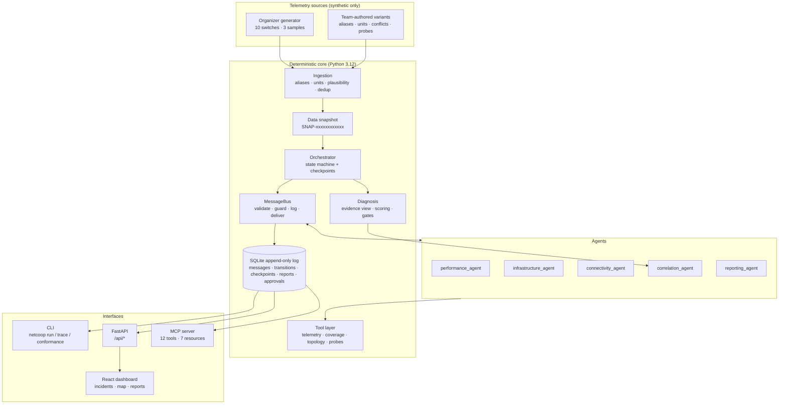
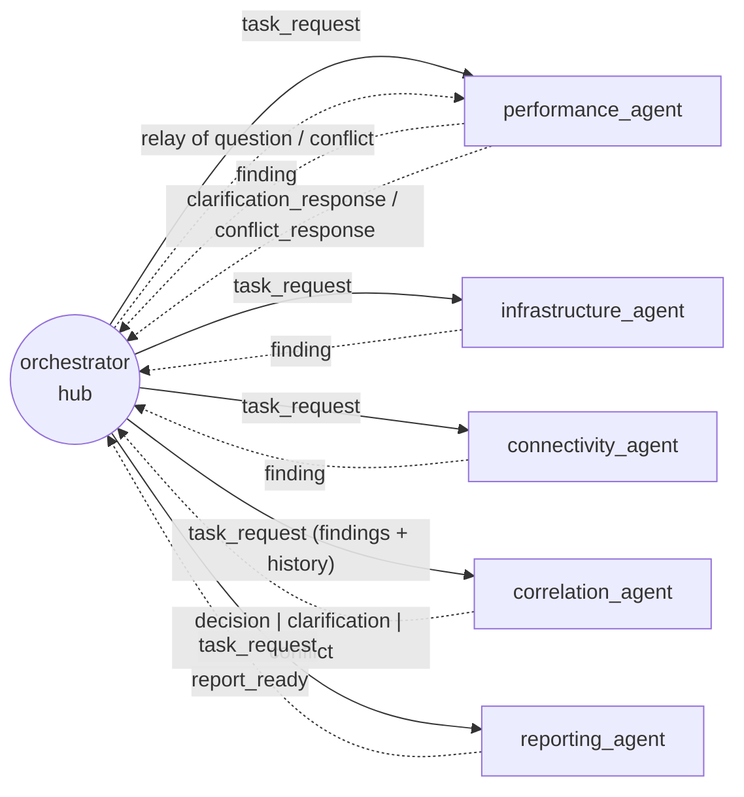
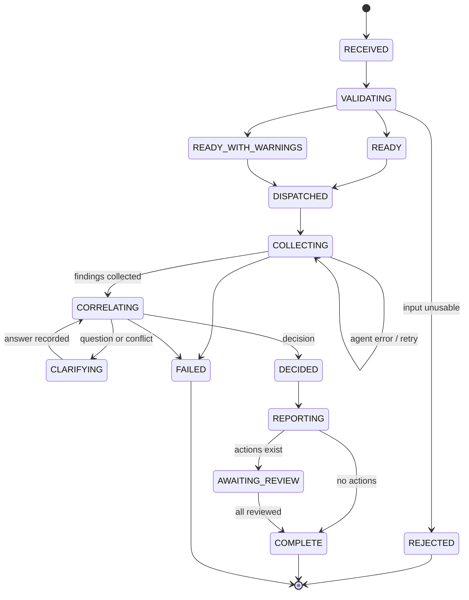
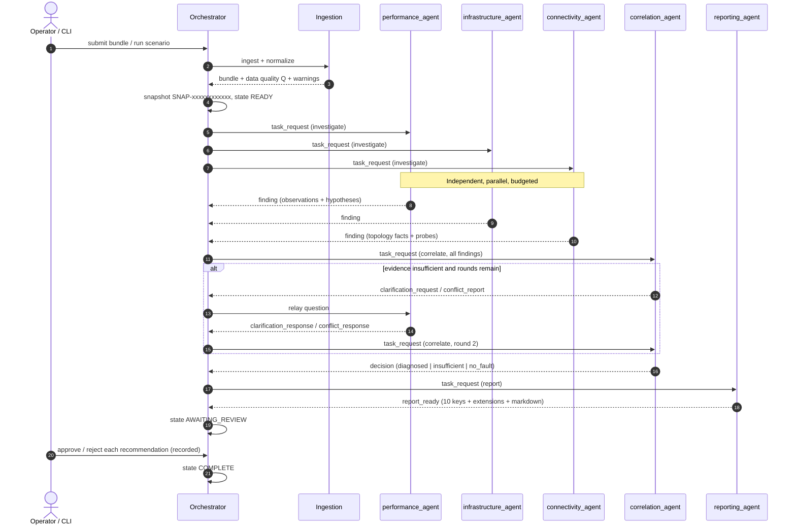

# NetCoop AI — Multi-Agent Network Fault Diagnosis and Interoperability

**Hackathon submission summary**
**Problem statement:** IIT Bhubaneswar Network Environment — Multi-Agent Network Fault Diagnosis and Interoperability
**Implementation status:** all twelve official components and both extensions implemented and verified on synthetic data
**Verification date:** 2026-11-01 · branch `develop` · Python 3.12 · 501 automated tests passing

> **One-line claim, precisely scoped:** five cooperating agents diagnose network faults from synthetic telemetry, exchange a versioned JSON protocol that is validated on every hop and logged append-only, and produce one evidence-linked report — or explicitly decline to diagnose when the evidence is insufficient. Nothing in this project touches a real network.

---

## At a glance

| Question | Answer | Evidence |
|---|---|---|
| How many agents? | 5 (3 specialists, 1 correlation, 1 reporting) coordinated by a deterministic orchestrator | `src/netcoop/agents/` |
| Is the protocol real? | Protocol 1.2, 10 message types, 39 controlled-vocabulary dictionaries, data-declared authority matrix | `src/netcoop/core/messages.py`, `config/protocol/authority.toml`, `config/vocabulary/` |
| Is it enforced? | Every message: size → schema → routing → reply linkage → conversation guard → sequence → log → deliver | `src/netcoop/core/bus.py`, `src/netcoop/core/guard/` |
| Does it work? | 13/13 scenarios, 501 tests, 43/43 conformance cases | `uv run netcoop scenarios run-all`, `uv run pytest -q`, `uv run netcoop conformance` |
| Does it admit uncertainty? | Yes — abstention with named reasons and a list of evidence that would change the decision | `src/netcoop/diagnosis/scoring.py` (`decide`) |
| Is any of it live? | No. Simulation mode only; every corrective action is simulated and human-approved | `src/netcoop/remediation/simulator.py` |

---

## 1. Project Overview

**Name:** NetCoop AI
**Tagline:** Cooperative multi-agent diagnosis for campus networks — one conversation, one evidence-backed root cause.

### Executive summary

Campus network faults are diagnosed today by a human correlating separate tool outputs: latency graphs from one system, interface counters from another, a student complaint from a ticket queue. NetCoop AI replaces that manual correlation with five narrowly-scoped agents that investigate independently, publish structured findings over a typed protocol, disagree explicitly when their data disagrees, and hand a single ranked diagnosis to an operator.

The engineering centre of gravity is **not** the diagnosis heuristic — it is the protocol, the validation, and the audit trail. Every message is a JSON envelope validated against a shared schema and a controlled vocabulary, checked against a data-declared authority matrix, rejected with a specific error code if illegal, and written to an append-only log before delivery. The result is a system where a judge, an operator, or a future non-Python agent can reconstruct exactly why a diagnosis was produced.

### Problem domain

Network fault diagnosis and root-cause analysis for campus-scale networks, where faults present as correlated symptoms (latency, loss, queue drops, interface errors, device status) across a topology.

### Target users

- Campus network operations teams (primary)
- Network engineers triaging user complaints
- Hackathon judges evaluating agentic architecture (secondary, but explicitly designed for)

### Core capabilities (all implemented)

1. Ingest heterogeneous telemetry bundles with alias mapping, unit conversion, timestamp handling, plausibility checks and de-duplication.
2. Fan out an incident to three specialist agents that investigate in parallel under a tool budget.
3. Correlate their findings into a ranked hypothesis set with a numeric confidence and explicit gate checks.
4. Ask bounded clarifying questions, or raise a formal conflict when agents' observations contradict each other.
5. Abstain instead of guessing: `insufficient_evidence` with reasons and a "what would change this" list.
6. Emit a report in the organizer's exact ten-key format plus an extension block.
7. Record human approve/reject decisions on recommendations and simulate (never execute) remediation.
8. Expose everything through a CLI, a REST API, an MCP server and a React dashboard.

### Objectives

Build a system that (a) demonstrates genuine multi-agent collaboration rather than a single prompt, (b) makes agent-to-agent interoperability explicit and testable, (c) produces diagnosable, evidence-linked output, and (d) degrades honestly rather than confidently when data is missing, stale or contradictory.

---

## 2. Problem Statement

### Why network troubleshooting is hard

A single user-visible symptom — "the network is slow" — can be caused by congestion on an egress link, a failing transceiver, CPU saturation on a distribution switch, a down DNS service, or a stale telemetry pipeline. These causes produce overlapping signatures:

- **Congestion** raises link utilization, latency, jitter and queue drops together.
- **Interface faults** raise interface error counters and packet loss, often with normal utilization.
- **Device overload** raises CPU and queue drops while utilization may stay healthy.
- **Hardware failure** flips device status and takes downstream segments with it.
- **DNS/DHCP failure** breaks name resolution while every link looks healthy.

### Fragmented telemetry

The data needed to separate these causes lives in different places and different shapes. Metrics arrive per device per timestamp; topology lives in a graph; service health lives in probes; user perception lives in complaints. Conventional monitoring shows each of these on its own screen, leaving the correlation — the actual diagnosis — to a human under time pressure.

### Why conventional troubleshooting is insufficient

| Conventional approach | Failure mode it does not address |
|---|---|
| Threshold alarms per metric | A single elevated metric rarely identifies a cause; alarms fire together without ranking |
| Dashboards | Show data, not competing explanations or their relative support |
| Rule engines | Hard-code one path; cannot weigh contradictory evidence or abstain |
| Single LLM prompt over logs | No schema, no validation, no audit trail, no reproducibility |
| Ticket triage | User reports are unverified and cannot confirm a cause alone |

### Relation to the IIT Bhubaneswar environment

The problem statement describes a campus network with segmented zones (hostels, academic blocks, library, data centre) and mixed symptoms. This implementation models exactly that shape — ten campus switches, a simulated topology with named zones, and generator-derived telemetry whose field names and ranges were taken from the organizers' own notebook — but it is **not connected to the real campus network**. All data is synthetic; the topology is explicitly labelled `SIMULATED`.

---

## 3. Proposed Solution

NetCoop AI is a four-stage pipeline. Each stage has a concrete implementation, not a concept.

### Stage 1 — Observe

`src/netcoop/ingestion/normalize.py` parses the bundle, applies declared field aliases (`config/aliases.toml`), converts units, normalizes timestamps, checks plausibility (a percentage cannot exceed 100), de-duplicates records, and classifies every entity/metric pair as `assessed`, `assessed_with_caveat` (stale) or `not_assessable` (missing, unmapped, malformed, implausible, unit-ambiguous). It computes a data-quality note:

```
completeness = assessed pairs / all pairs
freshness    = 1 - stale entities / entities
consistency  = 1 - bad records / kept records
Q            = min(completeness, freshness, consistency)
```

Missing data is never treated as healthy. A partly missing bundle is accepted with warnings; an unsupported schema major is rejected outright.

### Stage 2 — Analyze

Three specialists investigate the same scope independently: performance (latency, jitter, loss, utilization), infrastructure (status, CPU, queue drops, interface errors), connectivity (topology paths, zones, blast radius, DNS/DHCP probes). Each is bounded by a tool budget (30/30/40 calls) and follows the same adaptive pattern: screen the scope, check coverage to learn *why* data is missing, then deep-dive anomalous entities over the whole bundle to classify the pattern (sustained, spike, rising, intermittent) and find the onset.

### Stage 3 — Collaborate

Findings travel as typed messages through a hub-and-spoke bus. The correlation agent either decides, asks one targeted question (re-check a metric, assess more entities, widen the window, run a what-if), or raises a formal conflict naming the party that must respond. Clarification is capped at two rounds; every question and answer is recorded and carried into the next round.

### Stage 4 — Diagnose

Each catalogued cause is scored deterministically against signature evidence, penalized for contradictions and unexplained anomalies, and credited for cross-agent corroboration. A seven-check decision gate then decides `diagnosed`, `no_fault_detected`, or `insufficient_evidence`. Confidence is capped by data quality, missing topology and missing agents. The reporting agent builds the ten-key report, validates it, and attaches structured recommendations that all require human approval.

### Advantages over traditional troubleshooting

| Traditional | NetCoop AI |
|---|---|
| One screen per metric | One ranked diagnosis with alternatives and scores |
| Human correlates evidence | Three independent agents + deterministic correlation |
| Silent data gaps | `not_assessable` inventory shown in the report |
| Always answers | Abstains with reasons when gates fail |
| No audit trail | Append-only log of every message, including rejected ones |
| Untestable behaviour | 13 scenarios, 501 tests, 43 conformance cases |

---

## 4. Key Innovation and Unique Selling Points

**1. A protocol, not a prompt chain.** Agents communicate only through `Envelope` messages validated by `parse_message`, checked by a conversation guard, and logged before delivery. There is no in-process shortcut where one agent reads another's Python objects.

**2. Data-declared authority.** Who may send which message type, to whom, in which incident state, is a TOML table (`config/protocol/authority.toml`, 15 rows) enforced by `ConversationGuard`. Changing the conversation rules does not require touching agent code — and the guard rejects violations with named error codes.

**3. Independent findings, explicit disagreement.** Specialists never see each other's results. When two agents report contradictory values for the same entity/metric, the correlation agent can raise `conflict_report`; the named party must answer with a stance (`maintain`, `revise`, `withdraw`, `cannot_assess`). Unresolved conflicts are scored conservatively and preserved in the decision's `conflict_trail`.

**4. Missing is never healthy.** Every absence becomes a `NotAssessableItem` with a reason (`MISSING`, `UNIT_AMBIGUOUS`, `MALFORMED`, `IMPLAUSIBLE`), surfaced in the report. A cause whose required evidence is absent (weak Wi-Fi with no signal metric; DNS failure with no probes) is marked not diagnosable rather than scored zero and forgotten.

**5. Confidence with a ceiling, not a vibe.** The score is a documented heuristic; data quality sets a ceiling, and missing topology or a missing agent subtracts further. Confidence cannot exceed what the evidence supports.

**6. Graceful degradation everywhere.** Agents report errors instead of crashing the bus; the orchestrator retries once, records `AGENT_MISSING`, and continues; a failed reporting agent triggers a deterministic fallback builder; a malformed community complaint is dropped without affecting the core run; a paused incident resumes from checkpoints.

**7. Reproducibility.** Every incident is stamped with `SNAP-<12 hex>`, a fingerprint of the data bundle every agent analysed. Parallel and sequential specialist runs produce the same message sequence.

---

## 5. System Architecture

### Diagram



### Components

| Layer | Implementation | Notes |
|---|---|---|
| Frontend | React 19 + Vite 8 + TypeScript, Leaflet for the map | Separate build, served optionally by FastAPI |
| Backend API | FastAPI + Pydantic models | Read-only resources + four simulation-only write paths |
| Orchestration | `Orchestrator` state machine, checkpointed | 14 states, explicit allowed transitions |
| Agents | 5 classes in `src/netcoop/agents/` | Stateless between tasks |
| Protocol | `Envelope`, 10 payload types, `ConversationGuard` | Protocol 1.2, payload schema 1.0 |
| Data processing | Ingestion + `ToolBox`/`ToolSession` | Budgeted tool calls, recorded per finding |
| Graph analysis | `networkx` | Paths to core, edge-disjoint redundancy, blast radius |
| Storage | SQLite (`LogStore`) | Messages, transitions, incidents, reports, checkpoints, approvals |

### Data flow

1. A bundle enters via CLI, API upload or scenario runner.
2. Ingestion accepts, rejects or accepts-with-warnings, producing a normalized bundle and data-quality note.
3. The orchestrator fingerprints the bundle (`snapshot_id`) and checkpoints the input.
4. Three `task_request` messages are sent in fixed order; specialists investigate in parallel threads.
5. Each finding is validated, logged, and checkpointed on arrival.
6. The correlation agent receives all findings plus data quality, missing agents and clarification history.
7. It either decides or asks/raises a conflict; the orchestrator relays and records the exchange.
8. The decision triggers a reporting task; the reporting agent builds and validates the report.
9. The report is appended and the incident enters `AWAITING_REVIEW` (or `COMPLETE` if no actions exist).
10. Every step is readable via CLI trace, REST trace endpoint, MCP resource, or the dashboard.

---

## 6. Multi-Agent Architecture



Solid arrows are orchestrator-issued requests; dashed arrows are replies or relays. No agent-to-agent edge exists — that is enforced by the bus, not by convention.

| Agent | Responsibility | Input | Processing | Output | Partners | Failure behaviour |
|---|---|---|---|---|---|---|
| `performance_agent` | Latency, jitter, packet loss, link utilization | `task_request` (scope, window, budget) | Screen → coverage → deep-dive; pattern classification; local hypotheses (`link_congestion`, `upstream_congestion`, `interface_fault`) | `finding` with observations, hypotheses, not-assessable list, tool calls | Orchestrator (findings, clarifications) | Catches every exception and replies `agent_error`; bus never crashes |
| `infrastructure_agent` | Device status, CPU, queue drops, interface errors | Same task shape | Same pipeline; hypotheses (`device_failure`, `device_overload`, `interface_fault`, `link_congestion`); "status unknown" is an observation, never health | `finding` | Orchestrator | Same `agent_error` path |
| `connectivity_agent` | Scope, upstream paths, zones, blast radius, DNS/DHCP probes | Task + topology + probes | Traces paths to core, runs what-if failure on suspicious devices, emits probe observations; answers `what_if_cause` | `finding` with `facts` (paths, what-if, zones) + probe observations | Orchestrator | Missing topology → `TOPOLOGY_MISSING` limitation, not a crash |
| `correlation_agent` | Weigh all findings into one ranked decision | Task with full findings, data quality, clarifications, community context | Evidence view → conflict resolution → deterministic scoring → decision gate | `decision`, or `clarification_request`, or `conflict_report` | Orchestrator (relay only) | Failure → orchestrator records `AGENT_FAILED`, falls back to failure report |
| `reporting_agent` | Official report + recommendations | Task with decision, findings, provenance, snapshot | Builds 10 official keys + extension block, validates references, renders Markdown | `report_ready` | Orchestrator | Invalid/missing decision → schema-valid failure report; deterministic fallback exists |
| *(orchestrator — not an agent)* | Routing, state machine, retries, checkpoints | Input bundle | Sends tasks, validates replies, enforces deadlines (10 s), retries once, records every transition | State changes + incident result | All agents | Unresumable failure → `FAILED` with failure report |

**Why specialised agents instead of one general model?**

1. **Independent evidence.** Each specialist sees only its own metrics, so corroboration across agents is real rather than self-agreement by one model.
2. **Bounded, auditable work.** A tool budget and a named tool list per agent make behaviour inspectable and reproducible.
3. **Meaningful disagreement.** Specialisation creates the condition for conflicts (utilization vs. errors vs. status), which the protocol then handles explicitly.
4. **Isolated failure.** Losing one specialist degrades coverage by one evidence family; the run continues with a recorded limitation.
5. **Deterministic core.** Diagnosis is code, not generation, so the same input produces the same ranked output and the same confidence.

---

## 7. Agent Interoperability and Communication Protocol

### Communication architecture

All agent-to-agent communication is hub-and-spoke through `MessageBus`. A message with neither side set to `orchestrator` is rejected with `DIRECT_AGENT_MESSAGE_FORBIDDEN`. Agents never share memory or call each other's functions; the correlation agent's questions are relayed by the orchestrator, and the answer returns the same way. This is a deliberate constraint: it makes every exchange observable and every authority rule enforceable.

### Message lifecycle (every hop)

```
serialize → size check → JSON parse → envelope validation → payload rules
→ routing check → reply-linkage check → conversation guard → sequence stamp
→ append to log → deliver
```

Validation happens **before** delivery and again on the reply path. `MessageBus.accept_reply` re-validates replies in the caller's thread so that parallel specialists are logged in a deterministic order.

### Envelope structure

| Field | Meaning |
|---|---|
| `protocol_version` | `MAJOR.MINOR`, currently `1.2`; any minor of major 1 accepted |
| `message_id` | `<incident>-MSG-NNNNNN`; replies add `.R` |
| `incident_id` | Correlation identifier for the whole conversation |
| `in_reply_to` | Request id a reply answers; `null` to start a conversation |
| `sender`, `recipient` | Agent ids from a controlled vocabulary |
| `message_type` | One of ten types (below) |
| `sent_at` | Timezone-aware ISO timestamp |
| `payload_schema_version` | Payload contract version (`1.0`) |
| `status` | `ok`, `partial`, `error`, `rejected` |
| `snapshot_id` | `SNAP-<12 hex>` fingerprint of the analysed data (1.1+) |
| `mode`, `data_provenance` | `simulation`; data origin label (1.1+) |
| `seq` | Bus-assigned per-incident sequence, written under one lock (1.1+) |
| `payload` | Typed payload, discriminated by `message_type` |

### Real envelope (from `conformance/examples/valid/task_request_investigate.json`)

```json
{
  "protocol_version": "1.2",
  "message_id": "INC-0001-MSG-000001",
  "incident_id": "INC-0001",
  "in_reply_to": null,
  "sender": "orchestrator",
  "recipient": "performance_agent",
  "message_type": "task_request",
  "sent_at": "2026-11-01T09:00:00Z",
  "payload_schema_version": "1.0",
  "status": "ok",
  "snapshot_id": "SNAP-0123456789ab",
  "mode": "simulation",
  "data_provenance": "synthetic-generator",
  "payload": {
    "goal": "assess_performance",
    "scope_entities": ["SW_CAMPUS_1", "SW_CAMPUS_4"],
    "window": {"start": "2026-11-01T09:00:00Z", "end": "2026-11-01T09:15:00Z"},
    "tool_budget": 30,
    "deadline_s": 10,
    "task_id": "TASK-0001",
    "task_kind": "investigate",
    "input_message_ids": [],
    "incident_context": {"description": "illustrative example", "trigger": "telemetry_bundle"}
  }
}
```

### A real finding excerpt (same schema as a live run)

```json
{
  "protocol_version": "1.2",
  "message_id": "INC-0001-MSG-000001.R",
  "incident_id": "INC-0001",
  "in_reply_to": "INC-0001-MSG-000001",
  "sender": "performance_agent",
  "recipient": "orchestrator",
  "message_type": "finding",
  "sent_at": "2026-11-01T09:00:01Z",
  "payload_schema_version": "1.0",
  "status": "ok",
  "snapshot_id": "SNAP-0123456789ab",
  "mode": "simulation",
  "data_provenance": "synthetic-generator",
  "payload": {
    "task_id": "TASK-0001",
    "observations": [{
      "observation_id": "OBS-PERF-000001-001",
      "entity": "SW_CAMPUS_4",
      "metric": "latency_ms",
      "metric_category": "Latency",
      "value": 180.0,
      "unit": "millisecond",
      "window": {"start": "2026-11-01T09:00:00Z", "end": "2026-11-01T09:15:00Z"},
      "severity": "critical",
      "assessability": "assessed",
      "aggregation": "worst_by_severity",
      "sample_count": 3,
      "source_ref": ["REC-0001"],
      "agent": "performance_agent"
    }],
    "hypotheses": [{
      "hypothesis_id": "HYP-PERF-000001-001",
      "cause_type": "link_congestion",
      "entities": ["SW_CAMPUS_4"],
      "supporting": [{"evidence_type": "observation", "evidence_id": "OBS-PERF-000001-001", "stance": "supports", "strength": 0.8}],
      "local_score": 0.8,
      "score_method": "agent_local_heuristic",
      "rationale_code": "HIGH_UTILIZATION_WITH_DELAY"
    }],
    "not_assessable": [{"entity": "SW_CAMPUS_1", "metric": "status", "reason": "MISSING", "detail": "no status in the window"}],
    "limitations": [],
    "self_assessment": {"assessed_fraction": 0.5, "budget_exhausted": false}
  }
}
```

### Message types supported

| Type | Sender → recipient | Purpose |
|---|---|---|
| `task_request` | orchestrator → specialist / correlation / reporting | Delegate work; carries goal, scope, window, budget, deadline, task kind |
| `finding` | specialist → orchestrator | Independent result: observations, hypotheses, gaps, tool calls |
| `clarification_request` | correlation → orchestrator (relayed to target) | One targeted question per round |
| `clarification_response` | specialist → orchestrator | Answered, partially answered or declined with a reason |
| `conflict_report` | correlation → orchestrator (relayed) | Names parties, both sides, the rule, and the required re-check |
| `conflict_response` | specialist → orchestrator | Stance: `maintain`, `revise`, `withdraw`, `cannot_assess` |
| `decision` | correlation → orchestrator | Ranked hypotheses, margin, gate checks, abstention; exactly one per incident |
| `report_ready` | reporting → orchestrator | Ten official keys + extension block + Markdown + recommendations |
| `agent_error` | any → orchestrator | Structured timeout/crash/malformed-reply record |
| `community_candidate` | community module → orchestrator | Extension A aggregate; requires the feature flag |

### Shared controlled vocabulary

39 TOML dictionaries under `config/vocabulary/` define agents, message types, causes, severities, relations, stances, statuses, error codes, units, task kinds and more. Fields annotated `VocabTerm` reject unregistered values (`UNKNOWN_TERM`), so `link_congestion` means exactly one thing to every agent and to the report.

### Authority matrix

`config/protocol/authority.toml` declares 15 rows; each row fixes senders, recipients, legal incident states, reply semantics (`none`, `task_request`, `question`, `relayed_question`, `optional`), required `task_kind`, `once` constraints, `requires_decision`, round counting and extension gating. The guard evaluates these rows at runtime — including that only the correlation agent or orchestrator may send `conflict_report` and that a `conflict_response` must come from a named party (`CONFLICT_TARGET_NOT_PARTY`).

### Validation, versioning and backward compatibility

- **Versioning:** `MAJOR.MINOR`. Any minor of major 1 is accepted; newer minors are accepted with the `PROTOCOL_MINOR_NEWER` warning and unknown fields ignored; other majors are rejected (`PROTOCOL_VERSION_UNSUPPORTED`).
- **1.0 → 1.1:** optional envelope fields `snapshot_id`, `mode`, `data_provenance`, `seq`.
- **1.1 → 1.2:** adds `conflict_report`/`conflict_response`, `Hypothesis.relations`, `Decision.conflict_trail`. A reader pinned to 1.1 can be emulated in tests; 1.0-era logs still parse.
- **Payload rules:** eligibility of `evidence_id` references, stance/evidence agreement, prefix consistency, hypothesis-without-evidence, recommendation safety text, abstention consistency, clarification answer matching.
- **Unit normalization:** declared unit per field (`config/telemetry_fields.toml`); ambiguity (`UNIT_AMBIGUOUS`) or incompatible conversion (`UNIT_INCOMPATIBLE`) fails that metric to `not_assessable` rather than guessing.
- **Missing fields:** never fatal; recorded per pair with a reason and surfaced in `not_assessable`.
- **Size limit:** 1 MiB per message (`MESSAGE_TOO_LARGE`).

### Rejection is explicit, logged and educational

```
SENDER_NOT_AUTHORIZED: only correlation_agent may send a decision; performance_agent tried
DIRECT_AGENT_MESSAGE_FORBIDDEN: performance_agent -> infrastructure_agent bypasses the orchestrator
INCIDENT_CLOSED: incident INC-0001 is closed (COMPLETE); no further messages are accepted
CLARIFICATION_LIMIT_EXCEEDED: round 3 exceeds the limit of 2
EXTENSION_DISABLED: a community_candidate belongs to the community_signals extension, which is switched off
```

Rejected messages are stored with `valid = 0`, the error code and a plain-English reason, then raised to the sender — they are never delivered. `netcoop trace --show-rejected` keeps them visible.

---

## 8. End-to-End Execution Workflow

States: `RECEIVED → VALIDATING → READY[_WITH_WARNINGS] → DISPATCHED → COLLECTING → CORRELATING ⇄ CLARIFYING → DECIDED → REPORTING → AWAITING_REVIEW | COMPLETE`, with `REJECTED` and `FAILED` exits. Illegal transitions raise `IllegalTransition` rather than being silently tolerated.





### Observed sequence (scenario S-12, conflicting telemetry)

From `netcoop trace INC-0004` in a local run:

| seq | message | note |
|---|---|---|
| 1–3 | `task_request` ×3 | investigate, budget 30/30/40 |
| 4–6 | `finding` ×3 | 41, 30 and 0 observations (connectivity emits facts) |
| 7 | `task_request` | correlate, references 3 findings |
| 8 | `conflict_report` | `CONF-001`, `SW_CAMPUS_3 latency_ms` disagreement |
| 9 | `conflict_report` | orchestrator relay to the named party |
| 10 | `conflict_response` | stance `revise`, one re-checked observation |
| 11 | `task_request` | correlate, round 2 |
| 12 | `decision` | `insufficient_evidence`, abstains (`abnormal_measurements_present`, `below_score_threshold`) |
| 13 | `task_request` | report |
| 14 | `report_ready` | status `insufficient_evidence`, 2 recommendations |

That table is the whole architecture in fourteen lines: independent work, explicit disagreement, a bounded re-check, a defensible decision, and a report.

---

## 9. Fault Detection and Diagnosis Methodology

### Telemetry input

Ten campus switches, three samples each, fields observed in the organizers' generator: `cpu_utilization_pct`, `link_utilization_pct`, `packet_loss_pct`, `latency_ms`, `jitter_ms`, `queue_drops`, `interface_errors`, plus `status` and optional team-authored DNS/DHCP probes. Field names, ranges and citations live in `config/telemetry_fields.toml` with generator line numbers.

### Severity grading (deterministic, from `config/diagnosis.toml`)

| Metric | `elevated` above | `critical` at |
|---|---:|---:|
| CPU utilization % | 35 | 85 |
| Link utilization % | 50 | 90 |
| Packet loss % | 0 | 5 |
| Latency ms | 20 | 100 |
| Jitter ms | 5 | 30 |
| Queue drops | 0 | 1000 |
| Interface errors | 0 | 100 |
| Status | `Warning` | `Critical` |

These thresholds are team-chosen heuristics derived from the generator's normal/fault ranges — stated as heuristics in the config comments and in the report, not as calibrated values.

### Feature extraction, anomaly detection and pattern classification

Per entity/metric the agent computes worst severity, sample count, source record ids, and a temporal pattern (`sustained`, `spike`, `rising`, `intermittent`, `single-sample`) plus an onset timestamp. Anomaly detection is threshold-based severity grading (table above) rather than statistical or learned detection; the pattern layer is what distinguishes a transient blip from a persistent fault.

### Fault identification

Each cause in the catalog (`src/netcoop/diagnosis/catalog.py`) declares a weighted signature of key/supporting/weak items, contradicting observations, required evidence, and remediation text. Eight causes are supported: `normal_operation`, `link_congestion`, `upstream_congestion`, `weak_wifi` (not diagnosable without wireless data), `interface_fault`, `device_overload`, `device_failure`, `dns_dhcp_failure`, plus `telemetry_unreliable`.

### Deterministic vs. LLM reasoning

| Concern | Implementation |
|---|---|
| Severity, patterns, hypothesis generation | Deterministic code in agents |
| Evidence merging, conflict resolution, scoring, gates, abstention | Deterministic `diagnosis` package |
| Report assembly, validation | Deterministic builder with a fixed template |
| Narrative wording (optional) | LLM may only reword; disabled by default; output must pass a grounding check or the template is used |
| Cause selection | **Never** the LLM |

No real LLM provider is configured. The gateway ships with `NullProvider` (and a deterministic `StaticProvider` for tests); every LLM failure falls back to template text.

---

## 10. Root Cause Analysis and Confidence Scoring

### Scoring formula (implemented in `src/netcoop/diagnosis/scoring.py`)

```
support       = Σ(weightᵢ · evidenceᵢ) / Σ(weightᵢ)      weights: key 3.0, supporting 2.0, weak 1.0
contradiction = Σ(contradiction weights)                  strong 1.0, moderate 0.5
unexplained   = share of abnormal items the cause does not explain
corroboration = 0.1 if evidence comes from ≥ 2 independent agents, else 0
base          = clamp(support − 0.5·contradiction − 0.5·unexplained + corroboration + community_bonus)
score         = min(base, ceiling)
```

`ceiling` is a function of data quality and missing context:

| Data quality Q | Ceiling | Modifier |
|---|---:|---|
| ≥ 0.85 | 0.95 | −0.10 if topology missing |
| 0.70–0.85 | 0.85 | −0.15 per missing agent |
| 0.50–0.70 | 0.70 | |
| 0.30–0.50 | 0.50 | |
| < 0.30 | 0.30 | |

Community signals may add at most `+0.05` to the *displayed* confidence and never affect ranking or the gate.

### Decision gate

A cause is reported as `diagnosed` only if **all** hold:

| Check | Threshold |
|---|---|
| `score_at_least_tau` | ≥ 0.55 |
| `key_evidence_present` | at least one key signature item matched |
| `min_signature_items` | ≥ 2 matched signature items |
| `min_independent_sources` | ≥ 2 independent agents |
| `margin_at_least_delta` | lead over the runner-up ≥ 0.10 |
| `not_telemetry_unreliable` | top cause is not `telemetry_unreliable` |
| `diagnosable` | required evidence exists |

For `normal_operation` two more checks apply: coverage ≥ 0.60 and zero abnormal measurements. Failure of any check yields `insufficient_evidence`, confidence capped at **0.40**, and an abstention block naming the failed checks and the evidence that would change the decision.

### Worked example (S-02, real output)

| Element | Value |
|---|---|
| Cause | `link_congestion` on `SW_CAMPUS_4` |
| Support | 0.6364 |
| Contradiction | 0.0 |
| Unexplained | 0.1429 |
| Corroboration | +0.10 (infrastructure + performance agreed) |
| Base / score | 0.6649 |
| Ceiling | 0.95 (Q = 0.875) |
| Margin | 0.1818 over `device_failure` (0.48) |
| Status | `diagnosed`, category `medium` |
| Evidence | utilization 78.88 %, queue drops 35, latency 211.73 ms, jitter 66.76 ms, loss 1.5 %, status `Warning` |

Alternatives are always listed with their scores (`device_failure` 0.48, `device_overload` 0.47, `interface_fault` 0.17), so the operator sees the ranking, not just the winner.

---

## 11. Conflict Resolution Mechanism

### Contradictory observations (implemented)

`diag/evidence.py` merges observations per entity/metric in a fixed order:

1. **Evidence class** — direct measurement beats derived beats user report.
2. **Freshness** — newer window wins when windows differ by more than 300 s.
3. **Unresolved** — both readings kept, the scorer uses the *weaker* reading (conservative), and the conflict is recorded.

Unresolved conflicts additionally produce a `CONFLICT_UNRESOLVED` limitation and, while clarification rounds remain, a protocol-1.2 `conflict_report`. The named agent re-checks and responds with a stance. Every conflict ends up in `Decision.conflict_trail` as `resolved` or `unresolved_preserved`, with the preserved observation ids.

### Observed exchange (S-12)

```
seq=8  correlation_agent → orchestrator conflict_report
       CONF-001 observation_contradiction: SW_CAMPUS_3 latency_ms: observations disagree
seq=9  orchestrator → performance_agent    conflict_report (relay)
seq=10 performance_agent → orchestrator    conflict_response
       CONF-001 stance revise, 1 observation: re-checked reading: critical
```

The final decision remained `insufficient_evidence` (0.40) because the surviving abnormal measurement could still not be explained — the system does not let a resolved conflict manufacture a diagnosis.

### Other degradation cases

| Situation | Behaviour |
|---|---|
| **Missing agent** | `AGENT_MISSING` limitation, confidence ceiling −0.15, correlation proceeds with remaining findings |
| **Agent timeout** | 10 s deadline, one retry, then `agent_error` + missing agent |
| **Low confidence** | `insufficient_evidence`, capped at 0.40, abstention reasons listed |
| **Outdated telemetry** | `DATA_STALE` warning, `assessed_with_caveat`, freshness reduces Q and therefore the ceiling |
| **Missing metric** | `not_assessable` entry with reason; coverage and ceilings drop; never silent, never "healthy" |
| **Inconsistent schema/units** | `FIELD_ALIAS_APPLIED` / `UNIT_CONVERTED` / `UNIT_AMBIGUOUS`; unusable pairs excluded |

**Implemented vs. proposed.** Implemented: all rows above, plus conflict rounds and `conflict_trail`. Proposed future work: automatic weight learning from resolved conflicts, cross-incident conflict memory, and operator-facing "why did you disagree" replay. None of these are claimed as built.

---

## 12. Robustness and Error Handling

| Failure mode | Implemented behaviour | Evidence |
|---|---|---|
| Agent raises an exception | Agent catches it and replies `agent_error` (`AGENT_FAILED`); bus continues | `agents/base.py` `handle()` |
| Agent too slow | Deadline 10 s, `AGENT_TIMEOUT`, one retry, incident continues without it | `orchestrator/workflow.py` `_outcome` |
| Agent sends malformed reply | Reply re-validated; `MESSAGE_INVALID`, retry, then missing agent | `bus.accept_reply` |
| Invalid message content | Rejected, logged with code/reason, never delivered | `core/messages.py` |
| Illegal conversation move | Guard rejects with `SENDER_NOT_AUTHORIZED`, `REPLY_MISMATCH`, `MESSAGE_OUT_OF_SEQUENCE`, `INCIDENT_CLOSED`, `CLARIFICATION_LIMIT_EXCEEDED`, … | `core/guard/` |
| Oversized message | `MESSAGE_TOO_LARGE` before parsing | `core/parse.py` |
| Missing telemetry | Per-pair `not_assessable` reason; coverage and confidence fall | `ingestion/normalize.py` |
| Unsupported schema major | Bundle rejected → `REJECTED` incident with failure report | S-06b |
| Unparseable input | `INPUT_UNPARSEABLE` / `INPUT_NO_USABLE_METRIC` → failure report | `build_failure_report` |
| Reporting agent fails | Deterministic fallback report with identical content | `_report()` |
| Correlation agent fails twice | `FAILED` state + failure report | `_drive_stages` |
| Process crashes mid-run | Checkpoints allow resume in a new process; completed work is not redone | `tests/orchestrator/test_persistence.py` |
| Malformed community input | Dropped with a recorded reason; core run unaffected | S-06/extension tests |
| LLM unavailable or unsafe | Template text retained, `LLM_UNAVAILABLE` / `LLM_OUTPUT_REJECTED` | `llm/gateway.py` |
| API unknown incident | `404`; conflicting review state → `409` | `api/app.py` |

Logging is uniform: messages (`valid`, `error_code`, `violations_json`, `snapshot_id`, `verdict`), state transitions with triggers and detail, reports, checkpoints and approvals all live in SQLite. Incident state is derived from the transition log, not from mutable memory.

---

## 13. Technology Stack

| Category | Technology | Used for |
|---|---|---|
| Language (backend) | Python 3.12 | All diagnosis, protocol, orchestration |
| Language (frontend) | TypeScript | Dashboard |
| Backend framework | FastAPI + Uvicorn | REST API |
| Data models | Pydantic v2 | Envelopes, payloads, reports, settings |
| Messaging | Custom in-process bus + JSON envelopes | Agent interoperability (protocol 1.2) |
| Agent framework | **None** (deliberate) | Agents are plain classes on the bus |
| Database | SQLite | Append-only log, checkpoints, reports, approvals |
| Graph analysis | networkx | Paths, redundancy, blast radius |
| Frontend | React 19 + Vite 8 + Leaflet | Incidents, trace swimlane, map |
| AI/LLM | Provider-agnostic gateway, no provider configured | Optional narrative rewording only |
| Tool interface | MCP (Python SDK) | 12 tools + 7 resources; optional agent tool transport |
| Testing | pytest, Hypothesis, Vitest, Playwright | Unit → property → browser E2E |
| Quality gates | ruff, mypy `--strict`, `tsc -b` | CI on every push |
| CI | GitHub Actions | Lint, types, tests, scenarios, dashboard, E2E |
| Deployment | Local only | No hosted deployment exists |

---

## 14. Testing and Evaluation

### Measured results (re-run 2026-11-01)

| Check | Command | Result |
|---|---|---|
| Full suite | `uv run pytest -q` | **501 passed**, 7 browser tests deselected |
| Scenario suite | `uv run netcoop scenarios run-all` | **13/13 PASS** |
| Protocol conformance | `uv run netcoop conformance` | **15/15 valid accepted, 17/17 invalid rejected with the right code, 11/11 conversations** — PASS |
| Static checks | ruff, ruff format, mypy strict | Clean |
| Dashboard | `npm run build` (tsc + vite) | Builds; Vitest and 7 Chromium E2E tests exist (UI suite deselected by default) |

Test distribution: core 192, e2e 40, orchestrator 38, diagnosis 34, ingestion 28, agents 28, community 23, llm 22, tools 16, config 13, scenarios 12, inspector 12, conformance 12, api 11, geo 10, mcp 9, smoke 1.

### Scenario results

| Scenario | Focus | Expected | Actual |
|---|---|---|---|
| S-01 | Normal operation | `no_fault_detected` | PASS |
| S-02 | Link congestion | `diagnosed` / `link_congestion` | PASS |
| S-03 | Weak Wi-Fi, unmapped field | Never claims `weak_wifi` | PASS |
| S-04 | Interface fault | `diagnosed` / `interface_fault` | PASS |
| S-05 | DNS failure via probes | `diagnosed` / `dns_dhcp_failure` | PASS |
| S-06 | Renamed fields, units, minor version | Warning, no false diagnosis | PASS |
| S-06b | Unsupported schema major | `failed`, `INPUT_SCHEMA_VERSION_UNSUPPORTED` | PASS |
| S-07 | Partially missing metrics | Diagnosis or abstention; gaps listed | PASS |
| S-08 | Key evidence removed | `insufficient_evidence` | PASS |
| S-09 | Two near-equal explanations | `insufficient_evidence` after ≥ 1 clarification | PASS |
| S-10 | Specialist agent failure (injected) | Degrades, `performance_agent` missing | PASS |
| S-11 | Topology missing | Degrades, "No topology available" | PASS |
| S-12 | Conflicting and stale measurements | `insufficient_evidence`, conflict recorded | PASS |

### Required evaluation scenarios

| Requested case | Test input | Expected | Actual | Result |
|---|---|---|---|---|
| Normal operation | S-01, all metrics in range | No fault | `no_fault_detected` | **PASS** |
| High latency | S-02 (latency 211.73 ms, jitter 66.76 ms) | Flag delay, attribute to congestion | Diagnosed `link_congestion` | **PASS (indirect)** |
| Packet loss | S-02 (1.5 %), S-04 (loss with interface errors) | Attribute loss to a plausible cause | Correct cause in both | **PASS (indirect)** |
| Network congestion | S-02, S-11 | `link_congestion` on `SW_CAMPUS_4` | Matches | **PASS** |
| Connectivity failure | S-05 DNS/DHCP probe failure | `dns_dhcp_failure` or explicit non-assessability | Diagnosed `dns_dhcp_failure` | **PASS** |
| Missing telemetry | S-07, S-11, S-03 | Diagnose or abstain; list gaps | Gaps listed, no invented cause | **PASS** |
| Malformed agent messages | Fault injection `invalid`; invalid protocol examples | Rejected with code; run continues | Rejected, retried/missing agent | **PASS** |
| Agent failure | S-10 (`performance_agent: error`) | Degrade, not crash | `AGENT_MISSING` limitation | **PASS** |
| Conflicting findings | S-12 | Preserve both, cap confidence, re-check | `conflict_report` → `revise` → abstention | **PASS** |
| Multiple simultaneous faults | — | Would need a two-cause scenario | No dedicated scenario exists | **NOT TESTED** |

### Metrics — what is measured and what is not

- **Protocol conformance:** 43/43 declared cases pass (100 % of the kit). This measures protocol correctness, not field accuracy.
- **Scenario success:** 13/13 scenarios meet their declared expectations (status, cause, affected devices, limitations, warnings).
- **Diagnostic accuracy on real networks:** **not measured.** There is no labelled real-world dataset, and thresholds were derived from the same generator that produced most test inputs (circularity risk, documented in `docs/results/release-verification.md` §4).
- **Precision / recall / F1:** **not computed.** With 13 constructed scenarios and no independent ground truth, such figures would misrepresent performance.
- **Latency:** observed wall-clock on one Windows machine, including interpreter start — a single S-02 run ≈ 1.6 s, all 13 scenarios ≈ 2.7 s. This is an observation, not a benchmark.
- **Interoperability success rate:** 100 % of declared conformance examples; 0 rejected messages across a clean 13-scenario run.
- **Fault-handling success rate:** 13/13 scenarios meet their declared degradation expectations, including injected agent failure (S-10), missing topology (S-11) and conflicting/stale data (S-12).

---

## 15. Real-World Applications

| Domain | How the architecture transfers | What would be required first |
|---|---|---|
| University campus networks | Zone-based topology, per-switch telemetry, complaint intake — the modelled case | Authorized telemetry feed and device inventory |
| Enterprise networks | Same hub-and-spoke diagnosis over VLAN/branch topology | Site topology import; SNMP or streaming collector |
| Data centres | Correlation across pods and uplinks; blast-radius reasoning | Real topology discovery; higher-throughput ingestion |
| ISP infrastructure | Link congestion and interface fault signatures generalise | Calibrated thresholds per link class; capacity modelling |
| Telecom networks | Multi-domain evidence correlation with explicit conflict handling | Domain-specific cause catalogue; protocol extensions |
| Smart campuses | Fuse network telemetry with facility/user reports | Non-network data sources; governance for complaint data |

The transferable asset is the **pattern**: independent agents, typed evidence, declared authority, explicit conflict, confidence ceilings, and abstention. The diagnostic thresholds themselves would need recalibration per environment.

---

## 16. Security and Human Oversight

### Implemented

| Control | Implementation |
|---|---|
| Read-only diagnosis | No tool or agent has a write path to any device; tools only read the bundle |
| Agent permissions | Authority matrix declares who may send which message to whom, in which state; hub-only routing forbids direct agent-to-agent messages |
| No production access | No credentials, no network calls to devices; CI runs with no secrets |
| Human approval before action | Every recommendation has `requires_human_approval`; approval/rejection is recorded with reviewer, note and timestamp |
| Simulated remediation only | `remediation/simulator.py` returns text plans; it has no tool-layer or process access |
| Audit logging | Append-only messages, transitions, checkpoints, reports and approvals in SQLite |
| Credential handling | No credentials are used or stored; LLM keys are not required (no provider configured) |
| LLM containment | Rewording only; grounding check rejects new devices/metrics/numbers and forbidden wording; fallback to template |
| Complaint privacy | Reporter identifiers are pseudonymised at intake; responses never echo identities |
| CORS restriction | Allowed origins limited to the two local dev origins |
| Reviewer identity | Recorded with each decision; reviewer names are not authenticated |

### Not implemented (do not claim)

- No authentication or authorization on the API (local demo assumption).
- No TLS, rate limiting, CSRF protection, or multi-tenant isolation.
- No cryptographic message signing or agent identity verification.
- Reviewer identity is self-declared, not verified.

---

## 17. Limitations

1. **Synthetic data only.** Not connected to IIT Bhubaneswar's network; no live polling.
2. **Heuristic diagnosis.** Thresholds and weights are team-chosen and tuned on generator-derived data; real-world accuracy is unknown.
3. **No accuracy metrics.** Precision, recall and F1 are not computed and would be meaningless at this sample size.
4. **Weak Wi-Fi is never diagnosed** — the telemetry has no wireless signal field. DNS/DHCP is diagnosable only with team-authored probes.
5. **In-process transport.** Envelopes are transport-agnostic JSON, but no network transport or cross-language agent exists.
6. **SQLite single writer.** Sequence stamping and logging share one file and one lock; multiple workers are unsupported.
7. **No authentication.** The API is a local demo surface.
8. **Semantics drift between docs and code.** Some documents still cite the earlier test count (318) or mark now-built components as `PLANNED`; the code and this summary report current, measured values.
9. **Counter semantics unknown.** Whether `queue_drops`/`interface_errors` are per-sample or cumulative is unknown in the source generator; the report states this limitation explicitly.
10. **No demo video, no hosted deployment, no real LLM provider.**

---

## 18. Future Scope

All items below are **not implemented** and are labelled as future work.

| Enhancement | What it would add | Precondition |
|---|---|---|
| SNMP polling | Real device counters, interface state | Network-team authorization, credentials, polling design |
| Syslog ingestion | Event correlation with telemetry | Log schema mapping, retention policy |
| Real-time monitoring | Streaming instead of scenario playback | Time-series store, back-pressure strategy |
| Topology discovery | LLDP/CDP-derived graph instead of a static file | Read-only discovery credentials |
| MCP/A2A interoperability | Cross-vendor agent exchange | A2A endpoint design; MCP is already exposed read-only |
| Predictive detection | Forecast onset before thresholds trip | Historical baseline per device class |
| Human-approved remediation | Execute after approval | Change-management integration, rollback, least-privilege credentials |
| Multi-vendor support | Vendor field dictionaries and unit adapters | Vendor documentation and field mapping per platform |
| Calibrated confidence | Probability semantics instead of a heuristic score | Labelled incidents; calibration study |

---

## 19. Installation and Execution

### Prerequisites

- Python 3.12 (the project pins `>=3.12,<3.13`)
- [uv](https://docs.astral.sh/uv/) for dependency management
- Node 22+ and npm (dashboard only)

### Setup

```bash
uv sync                                      # locked dependencies
uv run python scripts/fetch_generator.py     # optional: fetch + SHA-256-verify organizer generator
```

### Run a diagnosis

```bash
uv run netcoop run --scenario S-02 --trace
uv run netcoop run --scenario S-02 --json-out report.json --md-out report.md
uv run netcoop run --input path/to/bundle.json --strict   # ten official keys only
```

### Inspect an incident

```bash
uv run netcoop incidents
uv run netcoop trace INC-0001
uv run netcoop trace INC-0001 --format sequence --show-rejected
uv run netcoop validate-report report.json
```

### Verify everything

```bash
uv run netcoop scenarios run-all
uv run netcoop conformance
uv run pytest -q
```

### Run the API

```bash
uv run fastapi dev            # http://127.0.0.1:8000, interactive docs at /docs
```

### Run the dashboard

```bash
npm --prefix dashboard ci
npm --prefix dashboard run build
NETCOOP_ENABLE=community_signals,geospatial NETCOOP_DASHBOARD_DIST=dashboard/dist uv run fastapi run
```

### Environment variables (all optional)

| Variable | Effect |
|---|---|
| `NETCOOP_DB` | SQLite path (default `var/netcoop.sqlite3`) |
| `NETCOOP_ENABLE` | Comma-separated feature flags: `community_signals`, `geospatial`, `llm` |
| `NETCOOP_DASHBOARD_DIST` | Serve a built dashboard from FastAPI |

### API surface (implemented)

`GET /api/health`, `GET /api/field-dictionary`, `GET /api/topology/{id}`, `GET /api/scenarios`, `GET /api/scenarios/{id}`, `POST /api/scenarios/{id}/run`, `GET|POST /api/incidents`, `GET /api/incidents/{id}`, `GET /api/incidents/{id}/report`, `GET /api/incidents/{id}/report.md`, `GET /api/incidents/{id}/trace`, `GET /api/incidents/{id}/messages/{message_id}`, `POST /api/incidents/{id}/resume`, `GET /api/incidents/{id}/review`, `POST /api/incidents/{id}/review/{index}`; extension routes `POST /api/community/complaints`, `GET /api/community/candidates`, `GET /api/community/stats`, `POST /api/community/candidates/{id}/investigate`, `GET /api/geo/layers`, `GET /api/geo/blast-radius/{entity}`, `GET /api/geo/incidents/{id}`.

### Demo script (5 minutes)

1. `uv run netcoop run --scenario S-02 --trace` — show three parallel investigations, one decision, one report.
2. `uv run netcoop trace INC-0001 --show-rejected` — show a rejected message with its code and reason.
3. `uv run netcoop run --scenario S-12 --trace` — show a conflict raised, answered, and preserved.
4. `uv run netcoop conformance` — show 43/43 protocol cases.
5. Open the dashboard and approve a recommendation — show that the outcome is simulated.

---

## 20. Demonstration and Screenshots

Existing screenshots in `docs/results/screenshots/`:

| File | What it demonstrates |
|---|---|
| `incident.png` | Incident view: verdict `Diagnosed`, confidence 0.66 against a 0.55 threshold, the swimlane of agent messages, six supporting evidence rows with sources, three alternatives with scores, three approval-gated actions, and the not-assessable inventory |
| `map.png` | Campus map: zone layout, telemetry-confirmed fault, user-reported unverified zone, and blast-radius overlay for a selected incident |
| `community.png` | Complaint intake: unverified report acknowledgement, then a clustered candidate incident with zone, devices, reporter count and symptom, ready to investigate |

What the screenshots already prove: independent agent messages, evidence linkage, alternatives, abstention inventory, human approval, and extension features.

Recommended additional captures before submission:

1. CLI `trace` output with `--show-rejected` (protocol enforcement is the highest-weighted criterion).
2. CLI `conformance` summary (15/15, 17/17, 11/11, PASS).
3. A degraded run (`--inject-fault performance_agent:error`) showing `AGENT_MISSING`.
4. FastAPI `/docs` listing the endpoints.
5. The report Markdown download, to show the official ten-key format.

---

## 21. Evaluation Criteria Mapping

| Criterion (weight) | Implementation | Supporting evidence | Key files | Remaining gap |
|---|---|---|---|---|
| **Agent Interoperability and Protocol Design (30 %)** | Protocol 1.2, 10 message types, 39 vocabularies, 15-row authority matrix, validate-log-deliver bus, version negotiation, conformance kit | 43/43 conformance cases; 0 rejected messages in 13 clean runs; live trace showing relay and rejection | `core/messages.py`, `core/bus.py`, `core/guard/`, `config/protocol/authority.toml` | In-process transport only; no A2A/networked interop |
| **Diagnostic Accuracy and Evidence Quality (25 %)** | 8-cause catalog, weighted signatures, contradiction/unexplained penalties, corroboration, evidence refs to observations and source records | S-02 diagnosis with 0.6649 and full evidence table; S-08/S-09 abstentions; report names evidence sources | `diagnosis/`, `agents/`, `report/builder.py` | No real-world accuracy, precision, recall or F1; heuristic thresholds |
| **Agent Orchestration and Conflict Resolution (15 %)** | 14-state machine, parallel fan-out, retries, bounded clarification (2 rounds), conflict messages, conflict trail, checkpoints/resume | S-12 conflict exchange + abstention; S-10 missing-agent run; pause/resume tests | `orchestrator/workflow.py`, `agents/correlation.py`, `diagnosis/evidence.py` | Multi-fault orchestration untested |
| **Robustness (15 %)** | Schema/guard rejection, agent error containment, fallback report, rejected-input reports, data-quality ceilings, fault injection | 17 invalid-message cases; S-06b rejection; S-10 degradation; persistence tests | `core/parse.py`, `core/guard/`, `orchestrator/faults.py` | No auth/TLS; single-writer SQLite |
| **Innovation, Usability and Extensibility (10 %)** | Honest abstention, conflict protocol, evidence ceilings, snapshot reproducibility, dashboard swimlane, community + geospatial extensions, MCP surface | Screenshots; S-03 refusal to diagnose Wi-Fi; map blast radius | `dashboard/`, `community/`, `geo/`, `mcp/` | Extensions are feature-flagged and demo-oriented |
| **Code Quality, Documentation and Demonstration (5 %)** | Typed strict code, 501 tests, CI, 17 design docs, CLI/API/MCP/dashboard surfaces | ruff/mypy clean; CI workflow; this document and `docs/` | repo-wide | Stale numbers in README/release notes; no demo video |

---

## 22. Conclusion

NetCoop AI treats interoperability as an engineering artefact rather than a claim. Five agents with genuinely separate evidence sources speak a typed, versioned protocol; every message is validated against a shared vocabulary and a declared authority matrix before it is delivered; every rejection carries a code and a plain-English reason; and every incident is reconstructable from an append-only log and a data snapshot fingerprint.

The diagnostic layer is deliberately conservative. It scores competing causes with documented weights, penalises contradictions and unexplained anomalies, caps confidence by data quality, missing topology and missing agents, and refuses to name a cause when the gate is not met. In the scenarios where data is contradictory (S-12), unsupported (S-06b) or absent (S-11), the system says exactly what it could not assess instead of producing a confident guess — which is the behaviour a real network operations team needs most.

For a hackathon evaluation, the strongest evidence is not a single accurate answer. It is that a judge can run `netcoop trace`, see the three independent investigations, see a conflict raised and answered, see an abstention with reasons, and know that 43 protocol conformance cases and 501 tests were executed to make that trace trustworthy.

**Scope statement:** simulation mode only; synthetic telemetry and a simulated topology; no connection to any real network; all remediation simulated and human-approved; diagnostic accuracy on real networks not measured.
